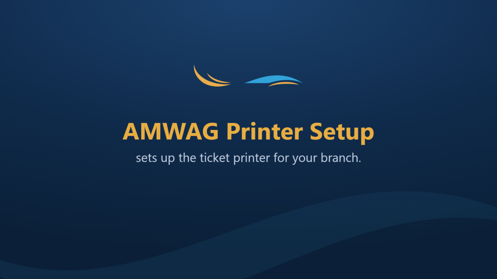
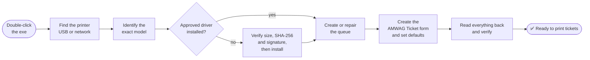
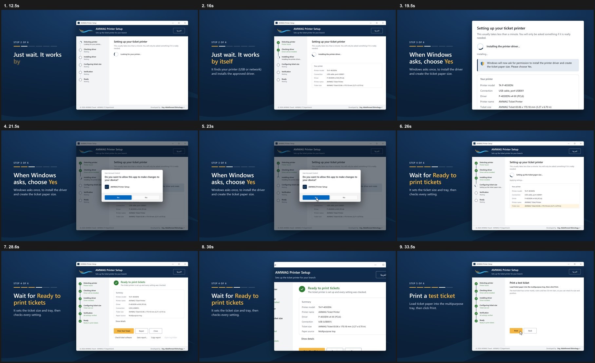

<div align="center">


# AMWAG Printer Setup

**One click. One ticket printer. Set up correctly, every time.**

*برنامج إعداد طابعة التذاكر لفروع أمواج — بنقرة واحدة*




</div>

---

## What it does

AMWAG Travel branches print tickets on **TA Triumph-Adler P-4030DN, P-4531DN and P-5032DN** printers. Setting one up by
hand means the right driver, a custom paper size, the right tray, portrait, single-sided, 100 % scale — and one wrong
click prints a ticket that doesn't fit the stock.

**AMWAG Printer Setup** does all of it for a branch employee. They double-click **`AMWAG Printer Setup.exe`**, press
**Yes** once when Windows asks, and wait for **Ready to print tickets**.



| | |
|---|---|
| 🔍 **Finds the printer** | USB Plug and Play IDs, IEEE 1284 IDs, existing queues, WSD queues and SNMP identity. No subnet scanning. |
| 🎯 **Exact identification** | Matches the hardware's own model strings; refuses unsupported or other-vendor devices. |
| 🛡️ **Trusted drivers only** | Reuses a working approved driver, or installs the official TA driver after checking its size, SHA-256 and catalog signature. |
| 🧾 **The ticket size, built in** | Creates the Windows form **AMWAG Ticket** (83.058 × 170.18 mm · 3.27 × 6.70 in) and makes it the queue default: portrait, simplex, 100 %, multipurpose tray. |
| ♻️ **Never duplicates** | Reuses existing queues, ports and forms instead of piling up copies. |
| ✔️ **Verifies, doesn't assume** | Re-reads every setting from Windows after applying it, then offers **Print Test Ticket** and **Check ticket software**. |
| 🌐 **English & Arabic** | Full right-to-left Arabic UI. |
| 🔐 **Asks for admin once** | A single UAC prompt, and only when a change actually needs it. No console window, ever. |
| 🧰 **Repair & Diagnostics** | **Repair** fixes an existing queue; **Diagnostics** only reports and changes nothing. |

## How it looks

<div align="center">

</div>

Training videos live in [`promo-video/`](promo-video/): a narrated Egyptian-Arabic tutorial
([`deliverables/AMWAG-Printer-Setup-Tutorial-EG-v1.mp4`](promo-video/deliverables/AMWAG-Printer-Setup-Tutorial-EG-v1.mp4))
and 60-second walkthroughs in [English](promo-video/AMWAG-Printer-Setup-Training-EN.mp4) and
[Arabic](promo-video/AMWAG-Printer-Setup-Training-AR.mp4).

## Quick start (IT)

> [!IMPORTANT]
> Setup and Repair stay blocked until the ticket size is confirmed in the configuration.

1. **Confirm the ticket size** in [`config/amwag-printer-config.json`](config/amwag-printer-config.json)
   (`ticket.dimensionsConfirmed`, `confirmedBy`, `confirmedOn`).
2. **Set each printer's MP tray paper size to *Custom*** on its control panel.
3. **Put the approved driver archive** in [`drivers/`](drivers/README.md) (it's a large vendor binary, so it's not in
   this repository; the build checks its size and SHA-256).
4. **Build:**

   ```powershell
   .\build.ps1
   ```

   → `dist\AMWAG Printer Setup\` plus a versioned zip.
5. **Run the [hardware acceptance checklist](docs/HARDWARE-ACCEPTANCE-CHECKLIST.md)** on real printers.

## Command line

The window is for employees. IT can also run it from a script or a deployment tool:

```powershell
"AMWAG Printer Setup.exe" --mode diagnostics --report C:\Temp\printer-report.txt
"AMWAG Printer Setup.exe" --silent --mode setup --address 192.168.1.50
"AMWAG Printer Setup.exe" --silent --mode setup --address 192.168.1.50 --model P-4030DN --confirm-model
```

| Switch | What it does |
|---|---|
| `--mode setup` | Default. Detect, install if needed, configure, verify. |
| `--mode repair` | Check and repair the ticket printer's existing queue. Never creates a queue. |
| `--mode diagnostics` | Inspect and report only. No changes, no UAC prompt. |
| `--address <host>` | Identify the network printer at this DNS name or IP (one SNMP query). |
| `--model <id> --confirm-model` | IT asserts the model when the printer can't report it. |
| `--report <path>` | Write the text report (and a `.json` next to it). |
| `--silent` | No windows. Setup and Repair need an elevated context. |

Exit codes: `0` ready · `1` ready with warnings · `2` not ready · `3` no supported printer · `4` decision needed ·
`5` admin required · `6` config invalid · `7` spooler unavailable · `8` blocked · `9` cancelled · `10` internal error ·
`11` bad arguments. The full meaning of each is in the [deployment guide](docs/DEPLOYMENT.md#7-command-line).

## Architecture

```
src/
├─ Amwag.PrinterSetup.Core       detection, planning, apply, verification, reports — no Windows calls
├─ Amwag.PrinterSetup.Windows    Win32: spooler, Plug and Play, driver store, WinTrust, SNMP
└─ Amwag.PrinterSetup.App        WinForms UI, command line, elevation broker/worker, silent mode, test ticket
tests/                           unit, scenario and read-only Windows integration tests
config/                          approved configuration and driver manifest
drivers/                         approved offline driver archive(s) — not in git
branding/                        logo, mark, favicon, app icon
promo-video/                     HyperFrames training videos (EN / AR / EG narrated)
build.ps1                        reproducible build, test, publish and packaging
```

The core is pure logic over interfaces; every Windows call lives behind them in `Amwag.PrinterSetup.Windows`. That's
what lets thousands of scenario tests run against in-memory fakes of the spooler, Plug and Play, network and driver
store. The UI runs as a standard user; changes happen in a short-lived elevated worker it talks to over a named pipe.
Read [ARCHITECTURE.md](docs/ARCHITECTURE.md) for the design decisions and safety rules.

## Building and testing

You need Windows 10/11 x64 and the **.NET 10 SDK** (`global.json` pins 10.0.401+) on the build machine only. The
published exe is self-contained.

```powershell
.\build.ps1                                                     # restore, build, test, publish, package
dotnet test AmwagPrinterSetup.sln --filter "Category!=Screenshots"
```

* **4,524 tests**, all passing (Core 643 · Windows 513 · App 3,368), 0 build warnings.
* `Category=WindowsIntegration` tests call real Windows APIs **read-only**. No test changes the PC's printers,
  drivers, forms, ports or services.
* `Category=Screenshots` renders every screen in English and Arabic for design review.

> [!NOTE]
> No TA Triumph-Adler printer was available during development, so **nothing has been physically verified yet**.
> [VALIDATION-STATUS.md](docs/VALIDATION-STATUS.md) separates what is implemented, tested, verified on Windows, and
> still needs a real printer.

## Documentation

| Document | Contents |
|---|---|
| [DEPLOYMENT.md](docs/DEPLOYMENT.md) | Configuration reference, branch files, distribution, silent mode, exit codes, what the tool writes |
| [TROUBLESHOOTING.md](docs/TROUBLESHOOTING.md) | Every finding code with its cause and fix, logs, common situations |
| [HARDWARE-ACCEPTANCE-CHECKLIST.md](docs/HARDWARE-ACCEPTANCE-CHECKLIST.md) | Physical tests per model and connection |
| [DRIVER-MANIFEST.md](docs/DRIVER-MANIFEST.md) | Verified driver packages, hashes, model coverage, signing analysis |
| [TICKET-SOFTWARE-INTEGRATION.md](docs/TICKET-SOFTWARE-INTEGRATION.md) | Why applications can override defaults, and how to check |
| [ARCHITECTURE.md](docs/ARCHITECTURE.md) | Design decisions, run sequence, identification and safety rules |
| [VALIDATION-STATUS.md](docs/VALIDATION-STATUS.md) | What is implemented, tested, verified on Windows, and what needs hardware |
| [research/](docs/research/) | Raw research: drivers, paper specs, Windows APIs, platform policy, network identity |

---

<div align="center">

Built for **AMWAG Travel · IT Department** · Developed by **Eng. Abdelhmeed Elshorbagy**

</div>
